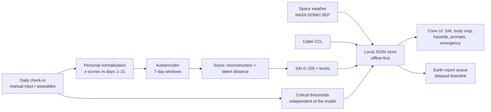

# Baseline — personal-baseline health monitoring for deep-space crews

**NASA Space Apps Challenge 2026 · Challenge: _Create Health Monitoring Software for Astronauts on Space Missions_ (author: Brazilian Space Agency)**

> **Prototype — synthetic data — not medical advice.** Synthetic data calibrated on published sources — proof of concept, not clinical validation. Not a medical device.

---

## 1. Overview

*Halfway to Mars, a crew member feels a sharp pain in the chest and collapses. There is no doctor on board and Earth is minutes away.* (the challenge author's scenario)

Baseline lets astronauts assess their own health on long missions along two paths:

- **Prevent** — one unsupervised model (a dense autoencoder) learns each astronaut's **personal normal** from daily self-measurements and turns the day into a single **Systemic Anomaly Index (SAI, 0–100)**, with an explanation of which indicators moved and a prompt for the next measurement.
- **Respond** — fixed critical thresholds and an emergency mode that work **independently of the model**, with an escalation ladder that accounts for the communication delay to Earth.

Every NASA Human Research Program hazard is visible in the product:

| NASA HRP hazard | How Baseline covers it | Data |
|---|---|---|
| Space radiation | daily and cumulative absorbed dose, alerts on solar particle events | real NASA DONKI SEP events + assumed dose model |
| Isolation & confinement | mind & sleep system (sleep, mood, reaction time); the model detects joint drift | synthetic |
| Distance from Earth | escalation ladder and Earth-report queue use the one-way communication delay | config per environment |
| Gravity fields | heart & circulation system (blood pressure, heart rate, exercise) | synthetic |
| Hostile & closed environment | cabin CO₂ against the NASA limit; infection onset via temperature and heart rate | synthetic |

Bone loss cannot be tracked with daily self-measurements and is out of scope (see Limitations).

## 2. Quick start

```bash
conda env create -f environment.yml && conda activate spaceapps
python -m src.donki --start 2024-05-01 --days 120   # needs internet once: caches real NASA DONKI SEP events
python -m src.run_all                               # simulate → train → tune + evaluate dev → export → figures
pytest -q
```

Training takes about 20 s on a laptop CPU. With an NVIDIA GPU: `python -m src.run_all --device cuda` (install the CUDA build of PyTorch first). CPU is the reference for bit-exact reproducibility.

UI concept: open `ui/concept/index.html` in a browser (works offline). See `ui/README.md`.

The one-time hold-out test is **not** part of `run_all`: `python -m src.evaluate --split test --final` (run once, after freezing `config/model.yaml` and `config/rules.yaml`).

## 3. How it works

1. **Daily check-in** — blood pressure, resting heart rate, fasting glucose, temperature, sleep, mood (1–5), reaction time; exercise minutes as context. The six indicators named in the challenge statement are all included.
2. **Personal normalisation** — each indicator is converted to a z-score against that astronaut's own calibration period (mission days 1–21). The model therefore sees *deviation from this person's normal*, not absolute values.
3. **Autoencoder** — a dense autoencoder (63 → 32 → 8 → 32 → 63) reads the last 7 days of 9 features. It is trained once on healthy windows pooled from 60 simulated astronauts; personalisation comes from step 2.
4. **Anomaly score** — the sum of two terms, each divided by its mean on healthy training windows:
   - *reconstruction error* — combinations of values the model cannot reproduce;
   - *latent distance* — Mahalanobis distance of the window's latent code from the healthy latent distribution, which catches large shifts along directions the model reproduces well (sleep, mood and reaction time also move together on healthy days, just never this far).
5. **SAI** — the percentile of the score among healthy validation windows (0–100).
6. **Alert levels** — yellow when SAI ≥ P_yellow on 2 consecutive days, orange when SAI ≥ P_orange on 2 consecutive days. P_yellow was tuned **on the development split only**, as the most sensitive value with ≤ 0.5 false alarms per astronaut-week. Red comes only from critical thresholds.
7. **Explanation** — the share of each indicator in the window's deviation from the personal normal ("what moved"), mapped to body systems and to the hazard strip; prompts ask for a targeted re-measurement.
8. **Escalation** — monitor → self-care → crew medical officer (orange, or yellow for 5 days, or 2+ systems) → flight surgeons (red; on Mars transit the onboard protocol comes first and the report is queued for downlink).

Reference methods the model is compared against:
- **B1 — fixed clinical thresholds** (e.g. AHA stage 2 hypertension, ADA hypoglycaemia), 2–3 days persistence.
- **B2 — personal single-indicator thresholds**: any indicator beyond 3 personal standard deviations on 2 consecutive days.

## 4. Architecture



## 5. Why unsupervised

There is no labelled dataset of astronaut illnesses: crews are tiny, serious events are rare and individual health records are private. A supervised classifier has nothing to learn from. A model of **each person's normal** needs no labels — it only needs healthy days, which every mission produces.

## 6. Data & sources

- **Real data:** NASA DONKI solar energetic particle events for the mission window (`python -m src.donki`). If the cache is missing, no SEP events are simulated and `meta.json` reports `space_weather.status = "missing"`.
- **Synthetic crews:** individual astronaut records are privacy-protected, so every astronaut is simulated from `config/simulation.yaml`. Day-to-day variation is correlated through two latent factors (fatigue, training load). Scenario sizes were fixed **before** any evaluation.

| Scenario | What changes (in personal standard deviations) | Role |
|---|---|---|
| S1 Cardiovascular deconditioning | heart rate +2.5, systolic +2.0, diastolic +1.5, reaction time +0.5; exercise −40 %; 21-day ramp | development |
| S2 Isolation & stress | sleep −2.0, mood −2.0, reaction time +2.0, heart rate +1.0; 14-day ramp | development |
| S3 Metabolic disturbance | glucose +2.5, sleep −1.0, mood −1.0; 14-day ramp | development |
| S4 Sensor fault | one indicator +6 for 5 days | development (sensor-fault flag) |
| S5 Infection onset | temperature +2.5, heart rate +2.0, sleep −1.5, mood −1.5, reaction time +1.0; 5-day ramp | **hold-out test only** |

Every configuration value is either sourced or flagged as an assumption: full list in [`outputs/results/config_sources.md`](outputs/results/config_sources.md) (generated by `python -m src.report_sources`). Sourced values: ISS sleep duration (Barger et al. 2014), CO₂ limit (NASA OCHMO / NASA-STD-3001), blood-pressure categories (AHA), hypoglycaemia levels (ADA), Earth–Mars communication delay (NASA ASCEND).

## 7. Results (development split)

40 development astronauts (10 per scenario + 10 healthy), the model at P_yellow = 90. *Synthetic data calibrated on published sources — proof of concept, not clinical validation.*

| Scenario | Detected: model / B1 / B2 | Median delay after onset (days): model / B1 / B2 | Model lead vs B1 (median, both detected) | Model lead vs B2 (median, both detected) |
|---|---|---|---|---|
| S1 Cardiovascular | 100% / 60% / 100% | 19 / 29 / 18.5 | +4 d; 4 cases found only by the model | −0.5 d |
| S2 Isolation & stress | 100% / 90% / 100% | 10.5 / 16 / 13.5 | +1 d; 1 case only by the model | −0.5 d |
| S3 Metabolic | 100% / 80% / 90% | 11.5 / 18.5 / 15 | +7 d; 2 cases only by the model | +5 d |

False alarms per astronaut-week on healthy days: **model 0.093, B1 0.093, B2 0.031** (one false alarm every ~11 weeks for the model).

**What this shows — and what it does not:**
- At the **same false-alarm rate as fixed clinical thresholds**, the model detects every development scenario and alarms earlier (median +1 to +7 days), finding 7 cases that fixed thresholds miss entirely.
- Against **personal single-indicator thresholds (B2)** the model is **on par, not better**: at its tuned threshold it detects more of the subtle (half-size) changes (90/80/90 % vs 60/50/60 %) but with 3× the false alarms; at a false-alarm rate matched to B2 (P_yellow = 97) it detects fewer of them. Most of the benefit therefore comes from **personalisation itself**; the model's added value on this data is the single systemic index, the explanation and the latent-distance term — not a detection advantage over B2. The hypothesis "the model beats per-indicator personal thresholds" is **not supported** on the development data.
- Full tables, sensitivity analysis (scenario size × 0.5 / 1.0 / 1.5) and the false-alarm-matched comparison: [`outputs/results/dev_metrics.md`](outputs/results/dev_metrics.md).

**Development history (kept for transparency).** v1 scored reconstruction error only and detected just 60 % of S2 on dev — the shift moved along a direction the autoencoder had learned as normal. v2 added the latent-distance term (one change, motivated by that diagnosis; scenarios and the hold-out untouched). v1 results: `outputs/results/history/`.

**Hold-out test (S5, infection onset):** not run yet. It is run once with `python -m src.evaluate --split test --final`; S5 was never seen during development.

Figures (1600 × 900, slide-ready): `outputs/figures/timeline_demo.png` (Crew Member Bravo: model alarm on day 60, fixed clinical thresholds on day 76), `outputs/figures/lead_time_dev.png`, `outputs/figures/healthy_check.png`.

## 8. Earth spin-off

The same offline, personal-baseline monitoring fits isolated crews on Earth: Antarctic research stations wintering without evacuation, remote communities with limited access to care, and long maritime deployments. A personal normal travels with the person; no labelled patient data or constant connectivity is needed.

## 9. Limitations

- All astronaut data are synthetic; results show the method works on plausible data, not that it works on real crews.
- Most simulation parameters are assumptions (listed in `config_sources.md`); spaceflight adaptation (e.g. fluid shifts) is not modelled — the healthy baseline is stationary.
- Daily granularity; no continuous wearable streams (HRV, SpO₂, respiratory rate) — possible future work.
- Bone loss is not covered (not measurable with daily self-measurements).
- The emergency-mode steps in the concept UI are placeholders until written from cited sources.
- Radiation dose values are illustrative; SEP event dates are real only after `src.donki` has been run with internet access.

## 10. Use of AI

Generative AI was used in this project, as required to be disclosed by the NASA Space Apps rules:
- **Claude (Anthropic)**, including via Claude Code, drafted the Python code, tests, configuration files, the concept UI, the figures and this README, and helped search for and verify sources. Every source file carries the header "AI-assisted: drafted with Claude (Anthropic), reviewed by the team".
- The team defined the concept, made the design decisions, reviewed and ran all code, and checked every cited source.
- No AI-generated images are used. No NASA logos or branding are used anywhere.

## 11. References

Data and scientific sources
- NASA Human Research Program — 5 Hazards of Human Spaceflight: https://www.nasa.gov/hrp/hazards/
- NASA Human Research Program — Risks of Human Spaceflight: https://www.nasa.gov/hrp/risks/
- NASA Human Research Program — Ongoing HRP Research in Space: https://www.nasa.gov/hrp/ongoing-hrp-research/
- NASA CCMC DONKI — Solar Energetic Particle events API: https://ccmc.gsfc.nasa.gov/tools/DONKI/
- NASA OCHMO Technical Brief OCHMO-TB-004, Carbon Dioxide: https://www.nasa.gov/wp-content/uploads/2023/12/ochmo-tb-004-carbon-dioxide.pdf
- NASA ASCEND paper, Communication Delays, Disruptions, and Blackouts for Crewed Mars Missions: https://ntrs.nasa.gov/api/citations/20220013418/downloads/ASCEND-Communication%20Delays%2C%20Disruptions%2C%20and%20Blackouts%20for%20Crewed%20Mars%20Missions.pdf
- Canadian Space Agency — Monitoring Radiation for Astronaut Health: https://www.asc-csa.gc.ca/eng/news/articles/2026/2026-02-26-monitoring-radiation-astronaut-health.asp
- Barger L.K. et al., sleep deficiency in astronauts, The Lancet Neurology (2014); press release: https://www.eurekalert.org/news-releases/595450
- American Heart Association — Understanding Blood Pressure Readings: https://heart.org/bplevels
- American Diabetes Association — Hypoglycemia (HCP): https://professional.diabetes.org/sites/dpro/files/2025-05/hypoglycemia-hcp-5-27-25.pdf

Software (open-source licenses)
- Python packages: NumPy (BSD-3-Clause), pandas (BSD-3-Clause), PyTorch (BSD-3-Clause), Matplotlib (Matplotlib license, PSF-based), PyYAML (MIT), Requests (Apache-2.0), jsonschema (MIT), pytest (MIT).
- Concept UI: React and ReactDOM 18 (MIT, bundled in `ui/concept/vendor/`), Tailwind CSS 3 (MIT, build time), Babel (MIT, build time).

## 12. License and disclaimer

Code and documentation: **Apache License 2.0** (`LICENSE`).
This is a research prototype built during a 48-hour hackathon on synthetic data. It is **not a medical device**, has **not** been clinically validated and must not be used for medical decisions.
