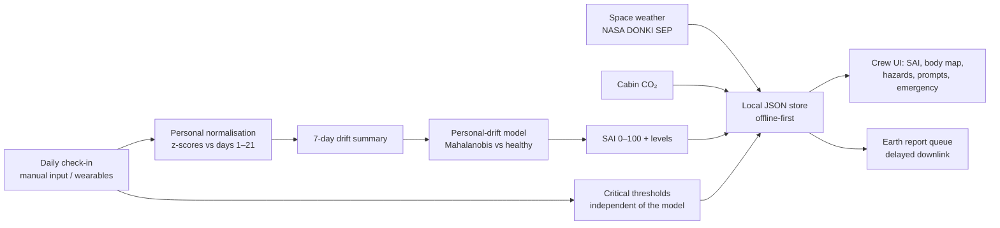
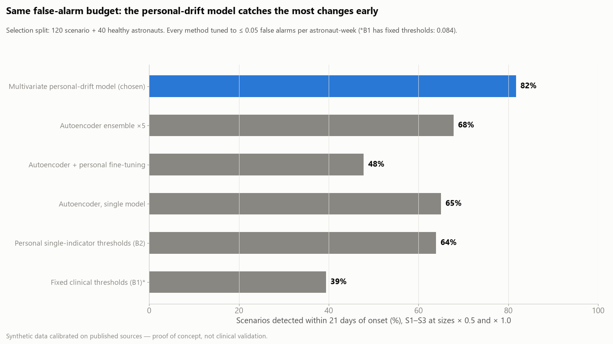
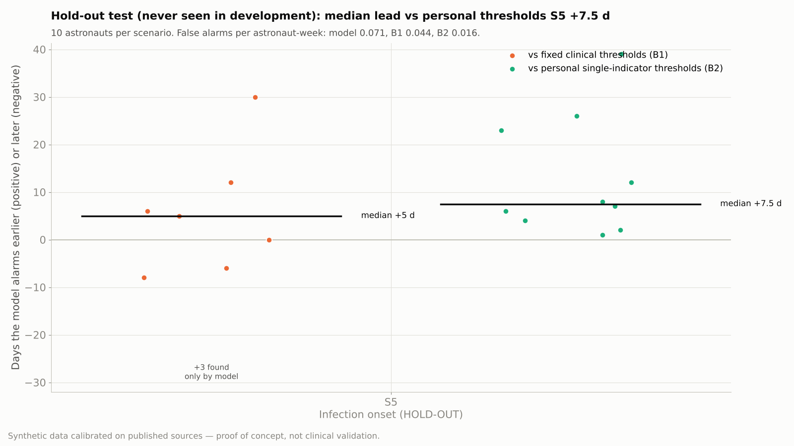

# Baseline — personal-baseline health monitoring for deep-space crews

**NASA Space Apps Challenge 2026 · Challenge: _Create Health Monitoring Software for Astronauts on Space Missions_ (author: Brazilian Space Agency)**

> **Prototype — synthetic data — not medical advice.** Synthetic data calibrated on published sources — proof of concept, not clinical validation. Not a medical device.

---

## 1. Overview

Halfway to Mars, “your fellow crew mate feels a sharp pain in the chest and collapses” — the scenario set by the challenge author, the Brazilian Space Agency, in the [challenge video](https://www.youtube.com/watch?v=RERG3gEmdC8) (0:43). Our addition: there is no doctor on board, and a message to Earth takes up to ~22 minutes one way.

Baseline lets astronauts assess their own health on long missions along two paths:

- **Prevent** — an unsupervised model of the **personal normal** (a multivariate personal-drift model, chosen in a benchmark against autoencoder variants) turns each day's self-measurements into a single **Systemic Anomaly Index (SAI, 0–100)**, with an explanation of which indicators moved and a prompt for the next measurement.
- **Respond** — fixed critical thresholds and an emergency mode that work **independently of the model**, with an escalation ladder that accounts for the communication delay to Earth.

Every NASA Human Research Program hazard is visible in the product:

| NASA HRP hazard | How Baseline covers it | Data |
|---|---|---|
| Space radiation | daily and cumulative absorbed dose, alerts on solar particle events | real NASA DONKI SEP events + assumed dose model |
| Isolation & confinement | mind & sleep system (sleep, mood, reaction time); the model detects joint drift | synthetic |
| Distance from Earth | escalation ladder and Earth-report queue use the one-way communication delay | config per environment |
| Gravity fields | heart & circulation system (blood pressure, heart rate, exercise) | synthetic |
| Hostile & closed environment | cabin CO₂ against the NASA limit; infection onset via temperature and heart rate | synthetic |

Bone loss cannot be tracked with daily self-measurements and is out of scope (see Limitations).

## 2. Quick start

```bash
conda env create -f environment.yml && conda activate spaceapps
python -m src.donki --start 2024-05-01 --days 120   # needs internet once: caches real NASA DONKI SEP events
python -m src.run_all                               # simulate → fit → tune on bench → confirm on dev → export → figures
python -m src.run_all --benchmark                   # same, plus the model-selection benchmark (~5 min on CPU)
pytest -q
```

The production detector fits in seconds on a laptop CPU; the benchmark trains nine autoencoders (about 30 s each on CPU, `--device cuda` in `src.train` for the alternative detector).

UI app (in progress): `cd ui/app && npm install && npm run dev`, or `npm run build` for a self-contained static site in `ui/app/dist/`. The built app is installable and works fully offline after the first visit (own service worker `ui/app/public/sw.js`, no extra library); check it with `npm run preview`, then stop the server and reload. UI concept: open `ui/concept/index.html` in a browser (works offline). See `ui/README.md`.

The one-time hold-out test is **not** part of `run_all`: `python -m src.evaluate --split test --final` (run once, after freezing `config/model.yaml` and `config/rules.yaml`).

## 3. How it works

1. **Daily check-in** — blood pressure, resting heart rate, fasting glucose, temperature, sleep, mood (1–5), reaction time; exercise minutes as context. The six indicators named in the challenge statement are all included. Image-based indicators (camera, ultrasound), which the challenge also allows, are out of scope: Baseline uses daily self-measurements only.
2. **Personal normalisation** — each indicator is converted to a z-score against that astronaut's own calibration period (mission days 1–21). The model therefore sees *deviation from this person's normal*, not absolute values.
3. **Drift summary** — for each day, the last 7 days are summarised as a weighted mean of the personal z-scores (latest day heaviest), one value per feature.
4. **Personal-drift model (unsupervised)** — a Gaussian model of that 9-dimensional summary is learned from 300 healthy simulated astronauts, with no illness labels. The anomaly score is the squared Mahalanobis distance of today's summary from the healthy model (a Hotelling T²-type statistic): it rises when several indicators drift together, even if each one alone still looks normal.
5. **SAI** — the percentile of the score among healthy validation days (0–100).
6. **Alert levels** — yellow when SAI ≥ 92 on 3 consecutive days, orange when SAI ≥ 99 on 3 consecutive days. P_yellow was tuned **on the selection split only**, as the most sensitive value with ≤ 0.05 false alarms per astronaut-week. Red comes only from critical thresholds.
7. **Explanation** — the score decomposes exactly into one term per indicator (T² = Σ d_f·(Σ⁻¹d)_f); the positive terms give "what moved", mapped to body systems and to the hazard strip; prompts ask for a targeted re-measurement.
8. **Escalation** — monitor → self-care → crew medical officer (orange, or yellow for 5 days, or 2+ systems) → flight surgeons (red; on Mars transit the onboard protocol comes first and the report is queued for downlink).

Reference methods the model is compared against:
- **B1 — fixed clinical thresholds** (e.g. AHA stage 2 hypertension, ADA hypoglycaemia), 2–3 days persistence.
- **B2 — personal single-indicator thresholds**: any indicator beyond 3 personal standard deviations on 2 consecutive days.

## 4. Architecture



## 5. Why unsupervised

There is no labelled dataset of astronaut illnesses: crews are tiny, serious events are rare and individual health records are private. A supervised classifier has nothing to learn from. A model of **each person's normal** needs no labels — it only needs healthy days, which every mission produces.

**Why not a deep model?** We benchmarked it (section 7). On daily data with 9 features, a well-specified statistical model of the healthy state beat every autoencoder variant, including ensembles and per-astronaut fine-tuning. It is also tiny (a 9 × 9 matrix), exactly explainable and trivial to run offline on any flight computer. The autoencoder remains in the code (`detector: autoencoder`) for richer, higher-frequency data in future work.

## 6. Data & sources

- **Real data:** NASA DONKI solar energetic particle events for the mission window (`python -m src.donki`). If the cache is missing, no SEP events are simulated and `meta.json` reports `space_weather.status = "missing"`.
- **Synthetic crews:** individual astronaut records are privacy-protected, so every astronaut is simulated from `config/simulation.yaml`. Day-to-day variation is correlated through two latent factors (fatigue, training load). Scenario sizes were fixed **before** any evaluation.

| Scenario | What changes (in personal standard deviations) | Role |
|---|---|---|
| S1 Cardiovascular deconditioning | heart rate +2.5, systolic +2.0, diastolic +1.5, reaction time +0.5; exercise −40 %; 21-day ramp | development |
| S2 Isolation & stress | sleep −2.0, mood −2.0, reaction time +2.0, heart rate +1.0; 14-day ramp | development |
| S3 Metabolic disturbance | glucose +2.5, sleep −1.0, mood −1.0; 14-day ramp | development |
| S4 Sensor fault | one indicator +6 for 5 days | development (sensor-fault flag) |
| S5 Infection onset | temperature +2.5, heart rate +2.0, sleep −1.5, mood −1.5, reaction time +1.0; 5-day ramp | **hold-out test only** |

Every configuration value is either sourced or flagged as an assumption: full list in [`outputs/results/config_sources.md`](outputs/results/config_sources.md) (generated by `python -m src.report_sources`). Sourced values: ISS sleep duration (Barger et al. 2014), CO₂ limit (NASA OCHMO / NASA-STD-3001), blood-pressure categories (AHA), hypoglycaemia levels (ADA), Earth–Mars communication delay (NASA ASCEND).

## 7. Results

*Synthetic data calibrated on published sources — proof of concept, not clinical validation.*

**Protocol.** (1) Model selection on a dedicated selection split (`bench`, new seeds: 30 astronauts per scenario S1–S3 + 40 healthy, scenario sizes × 0.5 and × 1.0), every method tuned to the **same false-alarm budget** (≤ 0.05 per astronaut-week). (2) Confirmation on the original development split with all thresholds frozen. (3) One run on the hold-out scenario S5 (infection onset), never seen during development; configuration frozen in git commit `c8723c2` before the run.

### 7.1 Model-selection benchmark



| Method family (best variant) | Scenarios detected within 21 days | Detected at all |
|---|---|---|
| **Multivariate personal-drift model (chosen)** | **82 %** | **96 %** |
| Autoencoder ensemble ×5 (300 training astronauts) | 68 % | 87 % |
| Autoencoder, single model (best architecture: 14-day window) | 65 % | 92 % |
| Personal single-indicator thresholds (B2) | 64 % | 88 % |
| Autoencoder + per-astronaut fine-tuning | 48 % | 74 % |
| Fixed clinical thresholds (B1, own false-alarm rate 0.084) | 39 % | 58 % |

38 configurations in total (architecture, training-set size, score components, smoothing, persistence, ensembles, fine-tuning, hybrids): [`outputs/results/benchmark.md`](outputs/results/benchmark.md). Combining the drift model with the autoencoder ensemble gave no gain (82 %), so the simpler model was chosen. Larger training sets *hurt* single autoencoders (they learn to reconstruct shifts too), and fine-tuning on 15 calibration windows overfits.

### 7.2 Confirmation split (thresholds frozen)

| Scenario | Detected: model / B1 / B2 | Median delay after onset (days): model / B1 / B2 | Model lead vs B1 (median) | Model lead vs B2 (median) |
|---|---|---|---|---|
| S1 Cardiovascular | 100 % / 60 % / 100 % | 11 / 29 / 18.5 | +18.5 d; 4 found only by the model | +7.5 d |
| S2 Isolation & stress | 100 % / 90 % / 100 % | 13 / 16 / 13.5 | −1 d; 1 found only by the model | −1.5 d |
| S3 Metabolic | 100 % / 80 % / 90 % | 8.5 / 18.5 / 15 | +7 d; 2 found only by the model | +8 d |

False alarms per astronaut-week: model 0.072 (above the 0.05 tuning budget — small-sample regression), B1 0.093, B2 0.031. At a false-alarm rate matched to B2 (model 0.028 vs B2 0.031), the model detects as many or more scenarios in every cell, and many more of the subtle half-size changes (S1 100 % vs 60 %, S3 80 % vs 60 %). Full tables: [`outputs/results/dev_metrics.md`](outputs/results/dev_metrics.md).

### 7.3 Hold-out test — infection onset (S5), evaluated once

| | Model | Fixed clinical thresholds (B1) | Personal single-indicator thresholds (B2) |
|---|---|---|---|
| Detected | **100 %** | 70 % | 100 % |
| Median delay after onset | **6 days** | 6 days | 14 days |
| Model lead (median) | – | +5 days (7 detected by both); 3 cases found only by the model | **+7.5 days** (all 10) |
| False alarms per astronaut-week | 0.071 | 0.044 | 0.016 |



S5 was never seen during development and was evaluated once (`outputs/results/final_test.json`, with timestamp and commit hash).

**What this shows — and what it does not:**
- The hypothesis is **supported on this synthetic data**: the personal-drift model detects deterioration earlier than both fixed clinical thresholds and per-indicator personal thresholds, including on a scenario type it never saw.
- The price is a higher false-alarm rate than the reference methods on the confirmation and test splits (about one false alarm per astronaut every 14 weeks); the operating point can be moved along this trade-off with P_yellow.
- The simulator is linear-Gaussian and the scenarios are gradual mean shifts — conditions that favour a Gaussian drift model. On real crew data with non-linear structure the ranking could change; the benchmark is built to be rerun on such data.

**Development history (kept for transparency).** v1 autoencoder (reconstruction only) missed 40 % of S2 on dev; v2 added a latent distance; the benchmark then replaced the autoencoder with the drift model. Earlier results: `outputs/results/history/`.

Figures (1600 × 900, slide-ready): `benchmark.png`, `lead_time_test.png`, `lead_time_dev.png`, `timeline_demo.png` (Crew Member Bravo: model alarm on day 58, fixed clinical thresholds on day 76; one false alarm on day 36 is marked), `healthy_check.png`.

## 8. Earth spin-off

The same offline, personal-baseline monitoring fits isolated crews on Earth: Antarctic research stations wintering without evacuation, remote communities with limited access to care, and long maritime deployments. A personal normal travels with the person; no labelled patient data or constant connectivity is needed. The challenge author names exactly this use — remote communities and places with limited access to health services — in the [challenge video](https://www.youtube.com/watch?v=RERG3gEmdC8).

## 9. Limitations

- All astronaut data are synthetic; results show the method works on plausible data, not that it works on real crews.
- Most simulation parameters are assumptions (listed in `config_sources.md`); spaceflight adaptation (e.g. fluid shifts) is not modelled — the healthy baseline is stationary.
- Daily granularity; no continuous wearable streams (HRV, SpO₂, respiratory rate) — possible future work.
- Bone loss is not covered (not measurable with daily self-measurements).
- The emergency-mode steps and the measurement guidance in the app are first-aid and self-measurement guidance paraphrased from the public sources listed in References; they are not a validated medical protocol and do not replace crew medical training or onboard procedures.
- Model selection used synthetic scenarios designed by the team; the winning model's advantage may partly reflect the linear-Gaussian simulator (see 7.3).
- Radiation dose values are illustrative; SEP event dates are real only after `src.donki` has been run with internet access.

## 10. Use of AI (Super Intelligence, SI)

Generative AI was used in this project, as required to be disclosed by the NASA Space Apps rules:
- **Claude (Anthropic)**, including via Claude Code, drafted the Python code, tests, configuration files, the concept UI, the figures and this README, and helped search for and verify sources. Every source file carries the header "AI-assisted: drafted with Claude (Anthropic), reviewed by the team".
- The team defined the concept, made the design decisions, reviewed and ran all code, and checked every cited source.
- No AI-generated images are used. No NASA logos or branding are used anywhere.

## 11. References

Data and scientific sources
- Brazilian Space Agency (AEB) — challenge introduction video, NASA Space Apps Challenge 2026 (source of the scenario quote and the Earth-application idea): https://www.youtube.com/watch?v=RERG3gEmdC8
- NASA Human Research Program — 5 Hazards of Human Spaceflight: https://www.nasa.gov/hrp/hazards/
- NASA Human Research Program — Risks of Human Spaceflight: https://www.nasa.gov/hrp/risks/
- NASA Human Research Program — Ongoing HRP Research in Space: https://www.nasa.gov/hrp/ongoing-hrp-research/
- NASA CCMC DONKI — Solar Energetic Particle events API: https://ccmc.gsfc.nasa.gov/tools/DONKI/
- NASA OCHMO Technical Brief OCHMO-TB-004, Carbon Dioxide: https://www.nasa.gov/wp-content/uploads/2023/12/ochmo-tb-004-carbon-dioxide.pdf
- NASA ASCEND paper, Communication Delays, Disruptions, and Blackouts for Crewed Mars Missions: https://ntrs.nasa.gov/api/citations/20220013418/downloads/ASCEND-Communication%20Delays%2C%20Disruptions%2C%20and%20Blackouts%20for%20Crewed%20Mars%20Missions.pdf
- Canadian Space Agency — Monitoring Radiation for Astronaut Health: https://www.asc-csa.gc.ca/eng/news/articles/2026/2026-02-26-monitoring-radiation-astronaut-health.asp
- Barger L.K. et al., sleep deficiency in astronauts, The Lancet Neurology (2014); press release: https://www.eurekalert.org/news-releases/595450
- American Heart Association — Understanding Blood Pressure Readings: https://heart.org/bplevels
- American Diabetes Association — Hypoglycemia (HCP): https://professional.diabetes.org/sites/dpro/files/2025-05/hypoglycemia-hcp-5-27-25.pdf

Crew-facing guidance in the UI app (`ui/app/src/content/texts.js`; paraphrased and linked, no text copied; checked 2026-11-14)
- NASA HRP risk pages: Cardiovascular Adaptations, Altered Immune System Responses, Inadequate Sleep and Irregular Schedules, Behavioral Changes and Psychiatric Disorders, Inadequate Food and Nutrition — https://www.nasa.gov/hrp/risks/
- NASA HRP hazard pages: Gravity Fields, Isolation and Confinement, Hostile/Closed Environments, Distance from Earth — https://www.nasa.gov/hrp/hazards/
- NASA, Space Radiation Won't Stop NASA's Human Exploration (shelter during solar particle events): https://www.nasa.gov/humans-in-space/space-radiation-wont-stop-nasas-human-exploration/
- NASA Human Research Roadmap, Psychomotor Vigilance Test (Reaction Self-Test) on ISS: https://humanresearchroadmap.nasa.gov/Tasks/task.aspx?i=1651
- Hinkelbein J. et al. (2020), Cardiopulmonary resuscitation (CPR) during spaceflight — a guideline for CPR in microgravity (DGLRM / ESAM-SMG), Scand J Trauma Resusc Emerg Med 28:108, CC BY 4.0: https://link.springer.com/article/10.1186/s13049-020-00793-y
- Tobin B.W. et al. (2002), Insulin secretion and sensitivity in space flight: diabetogenic effects, Nutrition 18(10):842–8: https://pubmed.ncbi.nlm.nih.gov/12361776/
- Van Dongen H.P.A., Maislin G., Mullington J.M., Dinges D.F. (2003), The cumulative cost of additional wakefulness, Sleep 26(2):117–26 (basis of the "Feels fine ≠ is fine" readiness check in the UI): https://pubmed.ncbi.nlm.nih.gov/12683469/
- American Heart Association: Home Blood Pressure Monitoring; Target Heart Rates; Warning Signs of a Heart Attack — https://www.heart.org/
- MedlinePlus (U.S. National Library of Medicine): CPR — adult (000013); Unconsciousness — first aid (000022); Breathing difficulties — first aid (000007); Chest pain (003079); Body temperature norms (001982); Blood sugar test (003482) — https://medlineplus.gov/ency/

Software (open-source licenses)
- Methods: Mahalanobis distance / Hotelling T² statistic (classical multivariate statistics); autoencoders for anomaly detection (benchmarked alternative).
- Python packages: NumPy (BSD-3-Clause), pandas (BSD-3-Clause), PyTorch (BSD-3-Clause), Matplotlib (Matplotlib license, PSF-based), PyYAML (MIT), Requests (Apache-2.0), jsonschema (MIT), pytest (MIT).
- Concept UI: React and ReactDOM 18 (MIT, bundled in `ui/concept/vendor/`), Tailwind CSS 3 (MIT, build time), Babel (MIT, build time).
- UI app (`ui/app/`): React and ReactDOM 18 (MIT, bundled into the build), Vite 6 (MIT, build time), @vitejs/plugin-react (MIT, build time), Tailwind CSS 4 and @tailwindcss/vite (MIT, build time). No web fonts, icons or images from third parties: system fonts and our own SVG.

## 12. License and disclaimer

Code and documentation: **Apache License 2.0** (`LICENSE`).
This is a research prototype built during a 48-hour hackathon on synthetic data. It is **not a medical device**, has **not** been clinically validated and must not be used for medical decisions.
